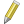
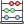

::::{grid} auto
:::{grid-item-card}
:class-card: sd-text-center sd-rounded-circle
:link: ../intro
:link-type: doc
{octicon}`home-fill;1.5em;sd-text-danger`
:::

::::

## Exercise 2: Disaster impact in different regions of Senegal 

## Characteristics of the exercise 

::::{grid} 2
:::{grid-item-card}
__Aim of the exercise__
^^^
Become familiar with different types of non-spatial analysis and geoprocessing tools. Understand the process of discovering relationships and connections between features in spatial data.

__Type of trainings exercise:__

- This exercise can be used in online and presence training. 
- It can be done as a follow-along exercise or individually as a self-study.

:::

:::{grid-item-card}
__Focus group (GIS-Knowledge Level)__
^^^

Information Management personnel with basic GIS experience

__These skills are relevant for:__

- connecting tabular data with spatial data
- Assessing disaster impacts using geodata
- creating maps and reports evaluating disaster impacts

:::
::::

::::{grid} 2
:::{grid-item-card}
__Estimated time demand for the exercise__
^^^
The time required for the exercise depends on the participants and the training setup. Online workshops will require more time, as participants will have to manage multiple windows on their computers at the same time, while trying to follow the training. 

The exercise will require between 1 and 2 hours.

:::

:::{grid-item-card}
__Relevant Wiki Articles__
^^^

* [Geodata Import in QGIS](../Wiki/en_qgis_import_geodata_wiki.md)
* [Non-spatial joins](../Wiki/en_qgis_non_spatial_joins_wiki.md)
* [Table functions](../Wiki/en_qgis_table_functions_wiki.md)
* [Geodata Classification](../Wiki/en_qgis_data_classification_wiki.md)

:::

::::

## Instructions for the trainers 

:::{dropdown} __Trainers Corner__ 

### Prepare the training 

- Take the time to familiarise yourself with the exercise and the provided material.
- Prepare a white-board. It can be either a physical whiteboard, a flip-chart, or a digital whiteboard (e.g. Miro board) where the participants can add their findings and questions. 
- Before starting the exercise, make sure everybody has installed QGIS and has downloaded __and unzipped__ the data folder.
- Check out [How to do trainings?](../Trainers_corner/en_how_to_training.md) for some general tips on facilitating trainings. 

### Conduct the training 

__Introduction:__

- Introduce the idea and aim of the exercise.
- Provide the download link and make sure everybody has unzipped the folder before beginning the tasks.

__Follow-along:__

- Show and explain each step yourself at least twice and slow enough so everybody can see what you are doing, and follow along in their own QGIS-project. 
- Make sure that everybody is following along and doing the steps themselves by periodically asking if anybody needs help or if everybody is still following.  
- Be open and patient to every question or problem that might come up. Your participants are essentially multitasking by paying attention to your instructions and orienting themselves in their own QGIS-project.

__Wrap up:__

- Leave time for any issues or questions concerning the tasks at the end of the exercise.
- Leave some time for open questions. 

:::

### Available Data 

:::{card}
:link: https://nexus.heigit.org/repository/gis-training-resource-center/Modul_5/Modul_5_Exercise1_Disaster_effects_in_different_regions_Senegal/Modul5_Exercise1_Disaster_effects_in_different_regions_Senegal.zip
__Download all datasets [here](https://nexus.heigit.org/repository/gis-training-resource-center/Modul_5/Modul_5_Exercise1_Disaster_effects_in_different_regions_Senegal/Modul5_Exercise1_Disaster_effects_in_different_regions_Senegal.zip) and save the folder on your computer and unzip the file.__
:::

| Dataset name                                | Description                                                                                                                           | Source                     | Download from                                                                         |
|:--------------------------------------------|:--------------------------------------------------------------------------------------------------------------------------------------|:---------------------------|:--------------------------------------------------------------------------------------|
| `sen_admbnda_adm1_1m_gov_ocha_20190426.shp` | Administrative boundaries of Senegal (admin level 1 – régions)                                                                        | UN OCHA                    | [HDX](https://data.humdata.org/dataset/senegal-administrative-boundaries)             |
| `sen_admpop_adm1_2020.csv`                  | Population statistics per région (2019 projection)                                                                                    | UN OCHA                    | [HDX](https://data.humdata.org/dataset/senegal-population-statistics)                 |
| `DI_Stat539.xls`                            | Disaster impacts per région (deaths, affected people, damaged houses, losses, …), summed over all recorded disaster events in Senegal | DesInventar Sendai (UNDRR) | [DesInventar](https://www.desinventar.net/DesInventar/profiletab.jsp?countrycode=sen) |

:::{Hint}
All files still have their original names. However, feel free to modify their names if necessary to identify them more easily.
:::

## Tasks 
Create an overview of the effects of disasters in the different regions of Senegal. Use non-spatial joins, the field calculator and symbology.

### Task 1: Join the population and disaster data to the regions 

1. Load the Senegal administrative boundary layer (`sen_admbnda_adm1_1m_gov_ocha_20190426.shp`), the population per region (`sen_admpop_adm1_2020.csv`) and the DesInventar Sendai data of Senegal (`DI_Stat539.xls`) into QGIS.

:::{Hint}
In the population file (`sen_admpop_adm1_2020.csv`), every number is followed by a space (e.g. `3880916 `). Because of this, QGIS might read the numbers as text. To make sure they are read as numbers, load the CSV via `Layer` → `Add Layer` → `Add Delimited Text Layer`. Under `Record and Fields Options`, tick `Trim fields` and `Detect field types`. Afterwards, check in the attribute table or the layer properties that the column `Total` is a number field.
:::

%% Reprojection step removed because projections are not covered yet at this point of the training. $area calculates in square metres on the ellipsoid anyway.
%% :::{Hint}
%% The projected coordinate system for Senegal is `EPSG:32628 WGS 84 / UTM zone 28N`
%% :::
%%
%% 2. Make sure to [reproject](../Wiki/en_qgis_projections_wiki.md) the dataset with the administrative boundaries into UTM zone 28N.

2. Take a moment to familiarise yourself with the layers. <kbd>Right-click</kbd> on each layer and open the attribute table to look at its columns and rows.
    - What kind of information is stored in the layers? (e.g., population statistics, disaster impacts)
    - Which column could be used to connect the tables with the spatial layer (the administrative boundaries)?

:::{figure} ../../../fig/en_ex1_AT_admin_pop_sen.png
---
width: 100%
name: attributes_all
---
Screenshot of the different attribute tables. The highlighted columns are relevant to connect the layers. 
:::

3. Perform [non-spatial joins](../Wiki/en_qgis_non_spatial_joins_wiki.md) to add the population and the disaster data to the administrative boundaries.
    - First, add the total population of each region to the administrative boundaries layer:
        - In the `Processing Toolbox`, search for "Join attributes by field value" and <kbd>Double-click</kbd> on it. A new window will open. 
        - __Input layer__: `sen_admbnda_adm1_1m_gov_ocha_20190426`
        - __Table field__: `ADM1_PCODE`
        - __Input layer 2__: `sen_admpop_adm1_2020`
        - __Table field 2__: `ADM1_PCODE`
        - __Layer 2 field to copy__: `Total`
    - Then, add the number of directly and indirectly affected people to the result of the first join. Use the same tool, and copy the columns `Directly affected` and `Indirectly Affected`.
        - Here, make sure to use the region names to connect the layers (`Region` in the DesInventar table).

:::{caution}
The column `Code` in the DesInventar table (`DI_Stat539.xls`) does __not__ contain a PCODE. It contains the number of disaster records per région. To join the disaster data to the administrative boundaries, use the région names instead. Note that Kaolack is spelled `KOALACK` in the DesInventar table but `KAOLACK` in the boundary layer, so this région will not be matched unless you correct the spelling.
:::

:::::{tab-set}

::::{tab-item} Screenshot population join
:::{figure} ../../../fig/en_ex1_Join_field.png
---
width: 80%
name: join_field
---
Screenshot of the tool Join Attributes by Field Value for the total population.
:::
::::

::::{tab-item} Screenshot disaster data join
:::{figure} ../../../fig/en_ex1_Join_field_2.PNG
---
width: 80%
name: join_field_2
---
Screenshot of the tool Join Attributes by Field Value for the directly and indirectly affected people.
:::
::::

:::::

### Task 2: Calculate the area and the population density 

You can open the field calculator from the attribute table: activate  `Toggle editing mode` and click on  `Open field calculator`. See the Wiki entry on [Table functions](../Wiki/en_qgis_table_functions_wiki.md) for more information.

1. Calculate the area of each region in square kilometres. Create a new field named `area_sqkm` with the field calculator. Choose `Decimal number` as the field type and use the expression `$area / (1000 * 1000)`.

:::{note}
`$area` calculates the area in square metres, even though the layer uses a coordinate system with degrees (`EPSG:4326`). Dividing by `1000 * 1000` converts square metres into square kilometres. You will learn more about coordinate systems and projections in a later module.
:::

2. Calculate the population density (people per square kilometre). Create another new field named `pop_per_sqkm`. Choose `Decimal number` as the field type and use the expression `"Total" / "area_sqkm"`.

:::::{tab-set}

::::{tab-item} Screenshot calculation `"area_sqkm"`
:::{figure} ../../../fig/en_ex1_area_sqkm.png
---
width: 80%
name: field_calculator
---
Screenshot of the area calculation using the field calculator.
::: 
::::

::::{tab-item} Screenshot calculation `"pop_per_sqkm"`
:::{figure} ../../../fig/en_ex1_pop_per_sqkm.png
---
width: 80%
name: field_calculator_2
---
Screenshot of the population per square km calculation using the field calculator.
:::
::::

:::::

3. Rename the fields `Directly affected` and `Indirectly Affected` to `directly_affected` and `indirectly_affected`. Field names without spaces are easier to use in expressions and in other tools. For this, use the tool `Rename field` from the `Processing Toolbox`.

:::{figure} ../../../fig/en_ex1_Rename_field.PNG
---
width: 80%
name: rename_field
---
Screenshot of the Rename field tool.
::: 

4. Save the final layer. The results of the joins and of `Rename field` are temporary layers (you can recognise them by the small chip icon next to the layer name). Temporary layers are lost when you close QGIS.
    - <kbd>Right-click</kbd> on the last layer (the result of the second `Rename field`) → `Export` → `Save Features As…`.
    - __Format__: `GeoPackage`
    - __File name__: save it in the `data/output` folder, e.g. as `sen_adm1_disaster_impact.gpkg`.
    - Click `OK`. The saved layer is added to your project. Use this layer for the next tasks. You can remove the temporary layers.

### Task 3: Calculate the percentage of affected people 

Now we calculate how many people in each region were affected, as a percentage of the total population of the region. For example, a value of `2` means that 2 % of the people in this region were affected.

1. Calculate the percentage of directly affected people. Create a new field named `per_direct_affected` with the field calculator. Choose `Decimal number` as the field type and use the expression `"directly_affected" / ("Total" / 100)`.

2. Calculate the percentage of indirectly affected people. Create a new field named `per_indirect_affected` in the same way. Use the expression `"indirectly_affected" / ("Total" / 100)`.

:::::{tab-set}

::::{tab-item} Screenshot directly affected
:::{figure} ../../../fig/en_ex1_per_direct_affected.PNG
---
width: 80%
name: per_direct_affected
---
Calculation of the percentage of directly affected people in each region.
:::
::::

::::{tab-item} Screenshot indirectly affected
:::{figure} ../../../fig/en_ex1_per_indirect_affected.PNG
---
width: 80%
name: per_indirect_affected
---
Calculation of the percentage of indirectly affected people in each region.
::: 
::::

:::::

### Task 4: Visualise the results 

1. Use the `Symbology` to show the percentage of directly affected people (`per_direct_affected`) in the different regions (Hint: `Graduated`).
    - Try different modes to find a useful colour scheme and classification.
    - Which regions are more affected and which are less affected? Are there any data gaps?

2. Export the map as a PNG (Hint: `Project` → `Import/Export` → `Export Map to Image`).

3. Repeat the previous steps, but this time show the percentage of indirectly affected people (`per_indirect_affected`).

:::{figure} ../../../fig/m5_ex2_indirectly_affected.png
---
name: m5_ex2_indirectly_affected
width: 750 px
---
Your layer could resemble something like this.
:::

4. What differences can you see between the regions with many directly affected people and the regions with many indirectly affected people?

:::{dropdown} __Data gaps__
Some regions have no values on the map. These are data gaps, not regions without disasters:

- __Directly affected:__ Louga, Matam, Sédhiou and Ziguinchor have no value for directly affected people in the DesInventar data.
- __Indirectly affected:__ Tambacounda has no value for indirectly affected people.
- __Kaolack:__ this region has no disaster data at all after the join, because it is spelled `KOALACK` in the DesInventar table (see the caution box in Task 1). If you corrected the spelling before the join, Kaolack has values.

When you present such a map, always mention the data gaps (e.g. in the legend as "no data"), so that nobody reads an empty region as "not affected".
:::
